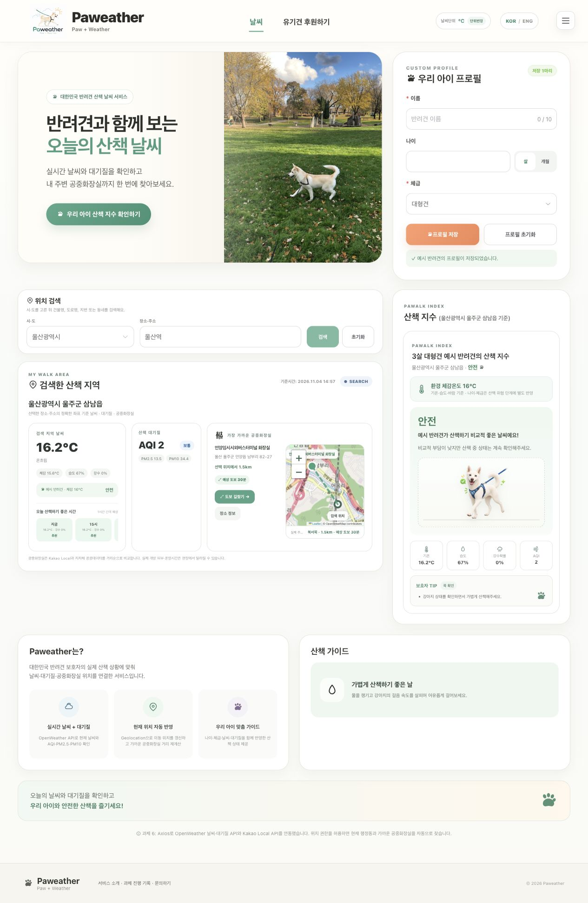
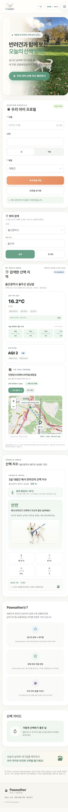

# Paweather — 반려견 산책 날씨

날씨·대기질·반려견 프로필을 연결해 산책 환경을 확인하고, 주변 공중화장실까지 찾는 Vue 웹 서비스입니다.

**[공개 데모](https://paweather-zeta.vercel.app)** · [문제 해결과 학습 기록](docs/learning-log.md) · [검증 범위](docs/verification.md)

| 항목 | 내용 |
| --- | --- |
| 프로젝트 성격 | Vue 날씨 과제를 반려견 산책 서비스로 확장한 학습 프로젝트 |
| 포트폴리오에서 보여주는 역량 | 외부 데이터 연동·정규화, 위치 기반 데이터 처리, 예외 상태 설계, 웹 서비스 구현 |
| 공개 초기 버전 / 후속 정리 | 2026-08 / 2026-11 |
| 기술 | Vue 3, Composition API, Pinia, Vue Router, Axios, Element Plus, Leaflet, Vite |
| 주요 데이터 | OpenWeather 날씨·대기질, Kakao Local 장소·주소, 일부 지자체 시설 정보 |

## 서비스 화면

실제 공개 데모에서 예시 프로필과 ‘울산역’ 검색으로 촬영한 화면입니다(2026-11-04). 날씨는 촬영 시점의 값이며, 코드 개선 후 재배포 상태를 증명하는 자료는 아닙니다.

<p>
  
  
</p>

## 핵심 구현과 해결한 문제

| 문제 | 구현 | 확인할 코드 |
| --- | --- | --- |
| 동네 이름만으로는 실제 장소를 찾기 어려움 | 장소·주소 검색을 병렬 실행하고 결과를 같은 형식으로 정리 | [kakaoLocalApi.js](src/services/kakaoLocalApi.js) |
| 행정동 표시 과정에서 선택한 장소 좌표가 바뀜 | 표시 주소와 API 조회용 정확한 좌표를 분리 | [WeatherParent.vue](src/components/paweather/WeatherParent.vue) |
| 검색 요청의 응답 순서가 입력 순서와 다름 | 새 검색·초기화 시 이전 요청을 무효화해 늦은 응답 반영을 차단 | [usePlaceSearch.js](src/composables/usePlaceSearch.js) |
| 현재 위치 갱신과 화면 계산이 한 파일에 집중됨 | 위치 구독, 검색, 산책 기준, 예보 보간, 언어 리소스 분리 | [composables](src/composables), [utils](src/utils), [i18n](src/i18n) |
| 3시간 예보로 가까운 산책 시간을 비교하기 어려움 | 예보 범위 안에서만 1시간 단위 선형 보간 | [forecast.js](src/utils/forecast.js) |

산책 단계는 **학습한 AI 모델이 아닌 규칙 기반 참고 지수**입니다. 배터리 프로젝트와 함께 데이터 처리 결과를 사용자 화면으로 연결하는 역량을 보여주기 위한 보조 대표작입니다.

## 로컬 실행

Node.js 22 LTS와 npm을 사용합니다.

```bash
git clone https://github.com/ncelinelee/Paweather.git
cd Paweather
npm ci
cp .env.example .env
# .env에 본인 OpenWeather·Kakao 키를 설정
npm run dev
```

위치 권한을 사용하지 않을 때도 시·도를 선택하고 ‘울산역’처럼 장소를 검색할 수 있습니다.

```bash
npm run check   # ESLint + 기능 테스트 + production build
npm run preview
```

테스트·빌드는 실제 API 키 없이 실행할 수 있습니다. 실시간 데이터 조회에는 키와 네트워크가 필요합니다.

## 구조와 데이터 흐름

```text
OpenWeather / Kakao Local
  → services/              요청·응답 정규화
  → composables/           위치 구독·검색 요청·반응형 상태
  → utils/                 산책 기준·단위 변환·예보 보간
  → components/paweather/  대시보드·프로필·지도·산책 결과
```

프로필·언어·온도 단위는 Pinia와 브라우저 저장소에 유지합니다. 검색 위치의 위도·경도와 표시할 행정동은 따로 관리합니다. 현재 위치는 약 500m 이동 시 외부 정보를 다시 조회하고 가까운 화장실까지의 거리는 좌표 갱신 때 다시 계산합니다.

## 검증

- 온도 경계값, 어린 반려견의 개월→살 변환, 취약 조건의 한 단계 보정
- 습도·바람을 반영한 환경 체감온도, 뇌우·대기질 위험 우선 처리
- 예보 보간과 범위 밖 시간의 예측 방지
- 실제 검색 상태에서 응답 순서 역전, 초기화 후 늦은 응답, 오프라인 요청 차단
- GitHub Actions에서 동일한 `npm run check` 실행

세부 결과와 수동 확인 범위는 [검증 기록](docs/verification.md)에 구분했습니다.

## 배포와 한계

Vercel은 `npm run build`와 `dist/`를 사용합니다. SPA fallback 및 Kakao 요청 rewrite는 [vercel.json](vercel.json)에 있습니다. 환경변수 이름은 [.env.example](.env.example)을 참고하세요.

- `VITE_` 값은 브라우저 번들에 포함됩니다. `.env` 제외만으로 비밀 키를 보호할 수 없으며, 비밀 자격증명이 필요한 운영 구조는 서버 측 프록시가 필요합니다.
- 1시간 단위 값은 보간한 예상값입니다. 범위 밖의 시간은 새 예측으로 만들지 않습니다.
- 산책 지수는 수의학적 검증을 받지 않았고 품종·질환·지면 온도 등을 반영하지 않습니다.
- 시설 개방 여부와 실제 보행 경로는 보장하지 않습니다. 도보 시간은 직선거리 기반 참고값입니다.
- 큰 원본 이미지와 UI 라이브러리로 인한 번들 경고가 남아 있어 이미지 최적화·필요 컴포넌트만 가져오기는 후속 과제입니다.

과제 1~9의 진행 과정은 [학습 기록](docs/learning-log.md)과 앱의 개발 기록 메뉴에서 확인할 수 있습니다.
